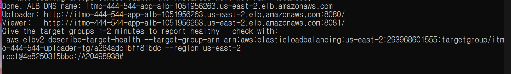
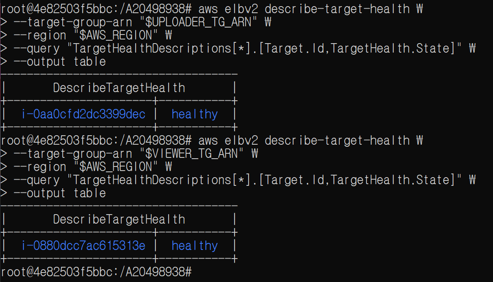
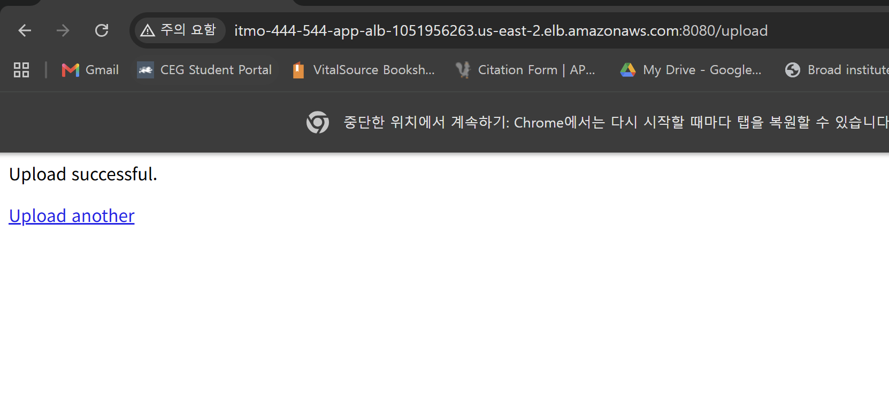
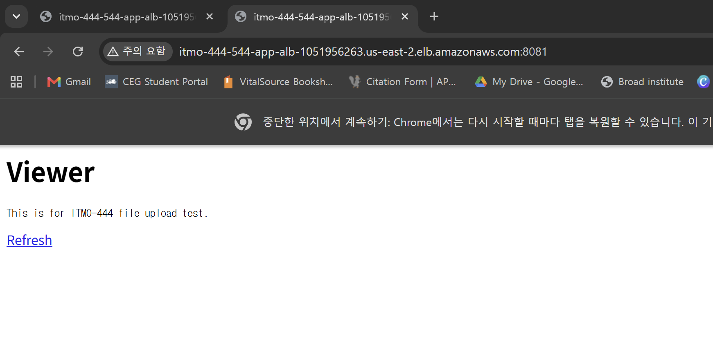
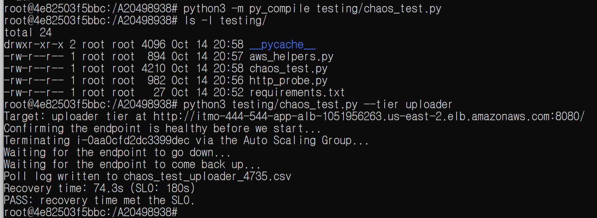
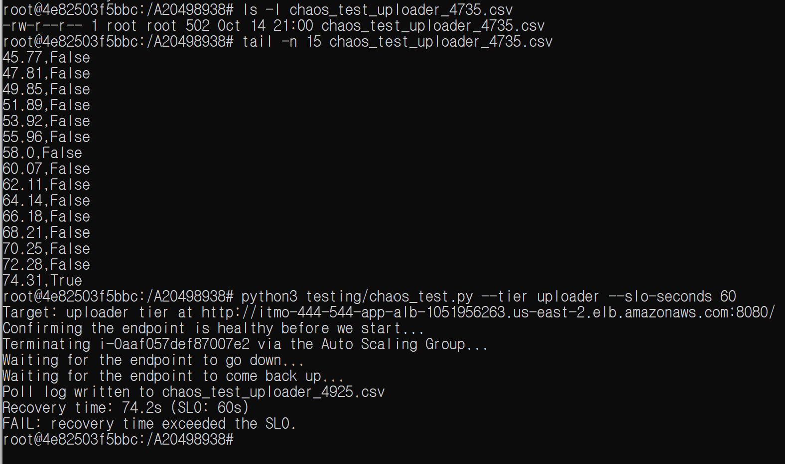
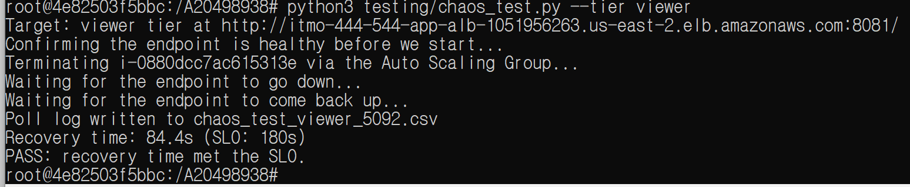
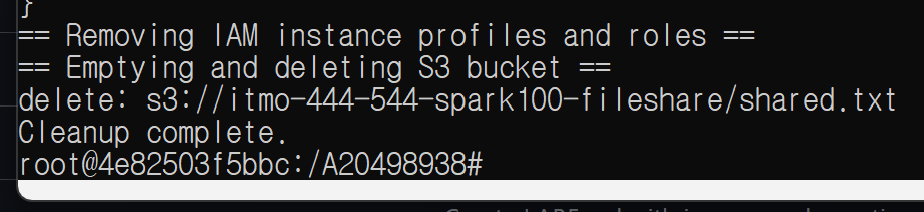

Lab 6

1.

2.

3.

4.

5.

6.

7.

8.

Questions

1. What Dominated the Recovery Time?

In my tests, the uploader recovered in about 74 seconds and the viewer recovered in about 84 seconds. Both passed the 180-second SLO. The uploader failed when the SLO was changed to 60 seconds. Most of the recovery time came from launching a new EC2 instance and waiting for the application to start. The target group health checks also added some time.

2. What Changed in the Create and Delete Scripts?

In the previous lab, the create script used run-instances to start EC2 instances directly. In this lab, Auto Scaling Groups replaced run-instances and automatically launched replacement instances. The Application Load Balancer and target groups were also added. The delete script was changed to remove the Auto Scaling Groups, load balancer, target groups, and related resources before deleting the older lab resources.
