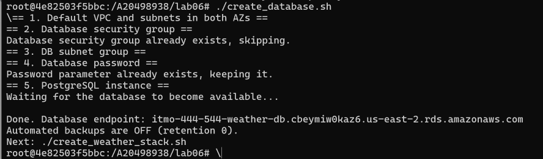
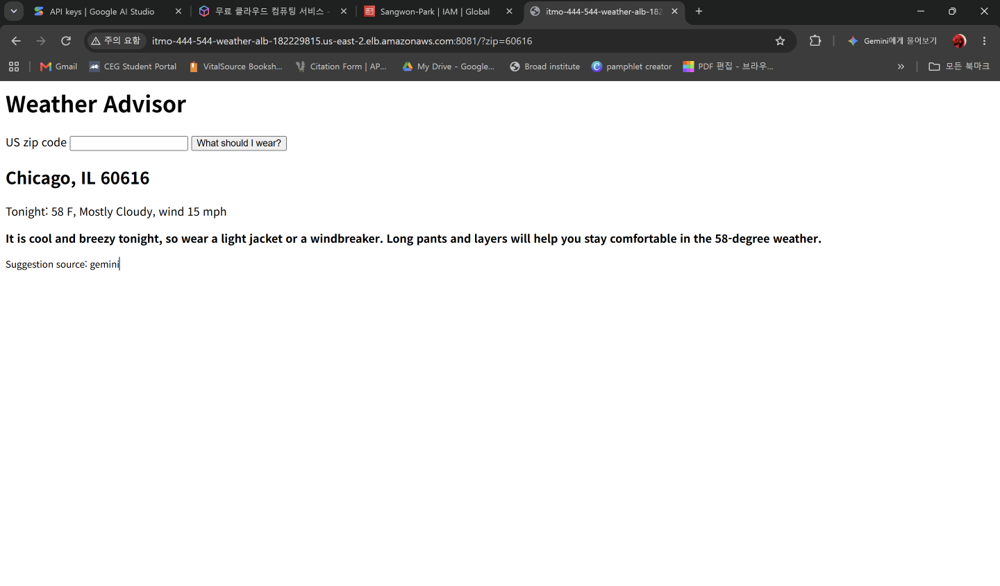
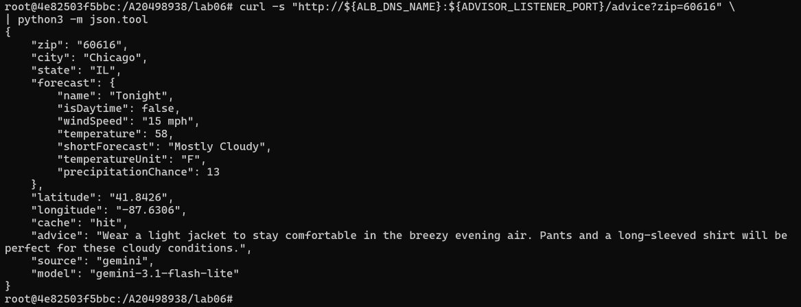
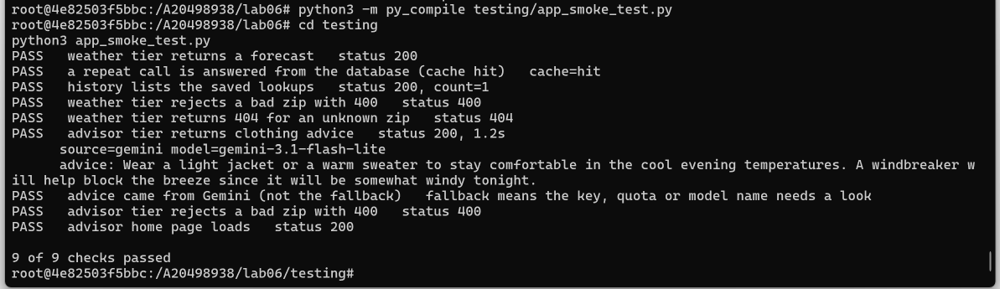
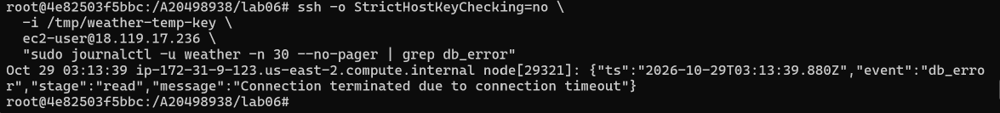

Lab 6

1.
ls -R lab06 | head -40

lab06:
advisor-app
create_database.sh
create_weather_stack.sh
db_outputs.env
delete_database.sh
delete_weather_stack.sh
previous
stack_outputs.env
testing
weather-app  

lab06/advisor-app:
app.js
package.json  

lab06/previous:
create_app_stack.sh
delete_app_stack.sh  

lab06/testing:
app_smoke_test.py
aws_helpers.py
chaos_test.py
http_probe.py
requirements.txt  

lab06/weather-app:
app.js
package.json  

This shows that the weather app, advisor app, testing files, and stack scripts were created inside lab06.

2.
curl -s https://api.zippopotam.us/us/60616 | python3 -m json.tool

Post code: 60616
Place name: Chicago
Longitude: -87.6306
Latitude: 41.8426
State: Illinois  

curl -s -o /dev/null -w "%{http_code}\n" https://api.zippopotam.us/us/00000

404

Forecast URL:

https://api.weather.gov/gridpoints/LOT/76,72/forecast

Two upstream calls are needed because the first call finds the location and forecast URL, and the second call gets the actual weather forecast.
3.

The PostgreSQL database was successfully created and automated backup retention was set to 0.
4.
BackupRetentionDays: 0
Class: db.t4g.micro
Encrypted: True
Engine: postgres
MultiAZ: False
Public: False  

DB snapshots:

[]

Automated backups:

[]

Direct database connection:

no connection (expected)

This proves that the database was encrypted, private, single-AZ, and had no snapshots or automated backups.
5.

The Advisor page and JSON both showed weather advice for ZIP 60616, and the advice source was Gemini.
6.

All nine smoke-test checks passed, showing that both tiers, caching, validation, Gemini, and the Advisor page were working correctly.
7.
weather_success zip=60616 cache=miss ms=528
weather_success zip=60616 cache=hit ms=1
weather_success zip=10001 cache=miss ms=232
weather_success zip=90210 cache=miss ms=247
weather_success zip=60616 cache=hit ms=1  

The log shows that a cache hit was much faster because the app did not need to call the external weather APIs again.
8.
/history:

Count: 3

ID 3 - ZIP 90210 - Beverly Hills, CA
ID 2 - ZIP 10001 - New York City, NY
ID 1 - ZIP 60616 - Chicago, IL  

PostgreSQL:

ID 3 - ZIP 90210
ID 2 - ZIP 10001
ID 1 - ZIP 60616  

saved_lookups = 3

There are fewer database rows than requests because cache hits reuse data that is already stored instead of saving another row.
9.
request 1: cache=miss time=0.595202s
request 2: cache=hit time=0.035752s

A short cache reduces calls to rate-limited external APIs and makes repeated requests faster. CACHE_SECONDS should not be too long because weather can change and old cached information may become inaccurate.
10.
===== itmo-444-544-weather-role =====
DB password: allowed
Gemini key: implicitDeny  

===== itmo-444-544-advisor-role =====
DB password: implicitDeny
Gemini key: allowed  

If an attacker takes over the Advisor tier, they may get the Gemini key, but they cannot get the database password.
11.
direct: 000
direct: no answer (good)
through the ALB: 200

A security group source rule allows traffic from resources using a specific security group, while a CIDR rule allows traffic based only on an IP address range.
12.
Chicago cache = unavailable
history while the database is cut off: 503

After restoring the database connection:

cache = hit

The 30-second pause prevents every request from repeatedly waiting for a failed database connection while the database is unavailable.    붙여넣은 텍스트(1)(9)
13.
fallback - Wear a light jacket or a sweater over long sleeves.
fallback - Wear a light jacket or a sweater over long sleeves.
fallback - Wear a light jacket or a sweater over long sleeves.

gemini_error zip=60616 status=400 reason=gemini_http_error
gemini_error zip=60616 status=400 reason=gemini_http_error
gemini_error zip=60616 status=400 reason=gemini_http_error  

After restoring the real Gemini key:

9 of 9 checks passed

Silent fallback can hide an API failure because users still receive an answer even when Gemini is not working.
14.
During the Weather tier outage:

{"error":"weather_service_unavailable"}

HTTP 502

Weather service recovered after 419 seconds

After recovery:

cache = hit

9 of 9 checks passed

State should be stored outside replaceable EC2 instances, such as in a database, so data is still available after an instance is replaced. The service was confirmed recovered by 419 seconds, although the actual recovery may have happened earlier because the first timing command had an error.    붙여넣은 텍스트(1)(9)
15.
Cleanup Verification

=== RDS instances ===
[]

=== RDS snapshots ===
[]

=== RDS automated backups ===
[]

=== DB subnet groups ===
[]

=== Load balancers ===
[]

=== Auto Scaling Groups ===
[]

=== Launch templates ===
[]

=== Lab IAM roles ===
[]

=== SSM parameters ===
[]

The empty lists confirm that the database, backups, load balancer, Auto Scaling Groups, launch templates, lab IAM roles, and SSM parameters were removed.

Required Paragraphs
1. Why Secrets Are Stored in SSM

The Gemini API key and database password are stored in SSM Parameter Store as SecureStrings so they do not need to be stored in .env, source code, or EC2 user-data. Each role can read only the secret it needs. This reduces the damage if one tier is compromised and lowers the chance of accidentally uploading a secret to GitHub.

2. Turning Backups Off

Turning RDS backups off saved backup storage and made it easier to completely remove the lab database. The disadvantage is that deleted data cannot be recovered. I would not turn backups off for important production data that needs to be restored after a failure.

3. Data Sent to Gemini

The Advisor sent only the ZIP code and public weather information such as temperature, wind, and forecast text to Gemini. It did not need to send private user information. This matters when using a free AI service because sensitive data should not be sent to a third party unless it is approved.

Questions
1. Secret Storage

Where else could each secret leak from?

Secrets could leak through shell history, process lists, logs, screenshots, files, or Git. Using hidden input and SSM SecureString reduces this risk.

2. Least Privilege

What would change if both roles had ssm:* on *?

Both roles could access every SSM parameter instead of only the secret they need. If one tier was compromised, an attacker could also access secrets used by the other tier.

3. Network Exposure

Why is the ALB open to the internet but the instances and database are not?

Users need to access the application through the ALB. The EC2 instances and database only need internal traffic, so they do not need direct internet access.

4. Shared Security Group

What can an Advisor instance do that it should not be able to do? How would you fix it?

The Advisor can send traffic to the database port because both tiers share the same app security group. I would create separate Weather and Advisor security groups and allow database access only from the Weather group.

5. Database Login

What would you create instead of using the master database user?

I would create a separate application database user with only the permissions it needs, such as SELECT and INSERT on the lookups table.

7. Encryption

What does certificate verification protect against that TLS alone does not?

TLS encrypts the connection, while certificate verification also checks that the application is connecting to the real RDS server instead of a fake server.

8. SQL Injection

Show one line of the app and explain what could go wrong if SQL was built by joining strings.

pool.query('INSERT INTO lookups (zip, payload) VALUES ($1, $2)', [zip, JSON.stringify(payload)])
The placeholders keep user input separate from the SQL command. If input was joined directly into the SQL string, malicious input could change the query.

9. Backups

What would you lose if the database contained real data, and what would you configure instead?

The data could not be recovered if the database was deleted or damaged. For real data, I would enable automated backups with an appropriate retention period.

10. Data Lifecycle

Who decides when stored data may be destroyed in a real organization?

The organization should decide based on business needs, retention policies, legal requirements, compliance rules, and the data owner.

11. Untrusted Output

What could an attacker gain if the page printed raw model output?

Malicious HTML or JavaScript could run in a user's browser. Escaping the AI output helps prevent this.

12. Data Sent to a Third Party

What would need to change before using a paid or school-owned Gemini account for real users?

The organization would need to review its privacy rules, data policies, account terms, and what user information is allowed to be sent to Gemini.

13. Abuse and Cost

How could someone use up the Gemini quota, and what could you add?

A user or bot could repeatedly call the public Advisor endpoint and use up the quota. Rate limiting, AWS WAF, authentication, and request limits could reduce this problem.

14. Availability

Why is it important that the response says source: fallback or cache: unavailable?

These values show that part of the system is not working normally. Without them, users or administrators may think Gemini or the database is working when it is actually unavailable.
