Lab 8

1.
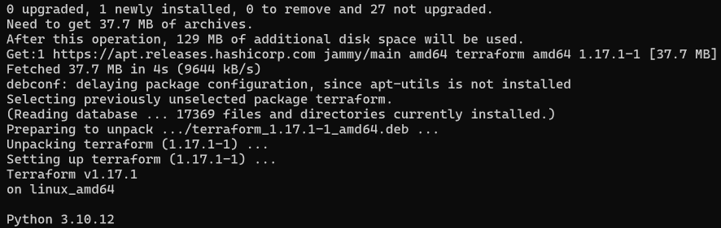

Terraform is installed. The version is 1.17.1.

2.
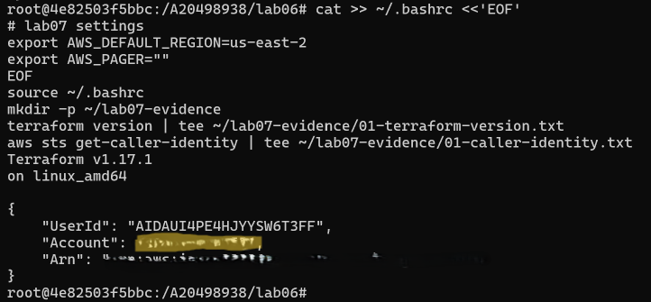

Terraform version and my AWS account check. The account number is hidden.

3.
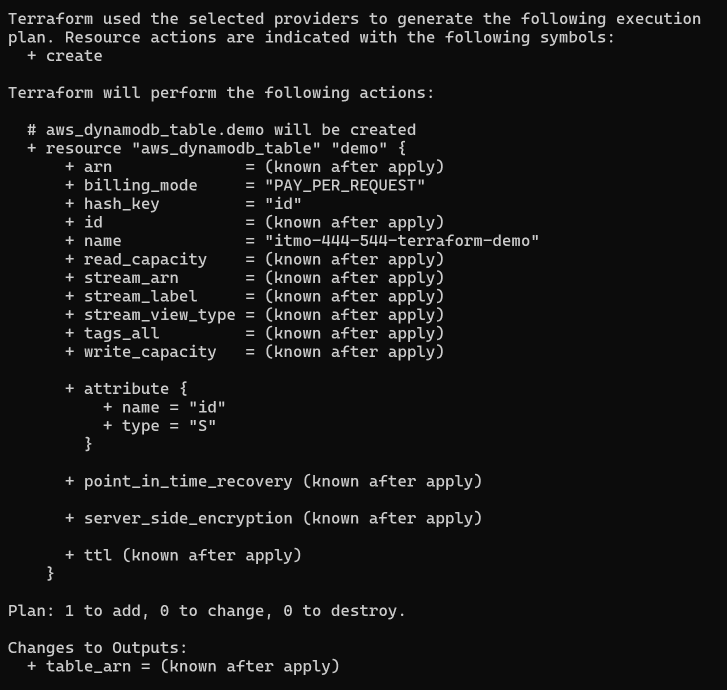

Part A: the plan before the first apply. It will add 1 table.

4.
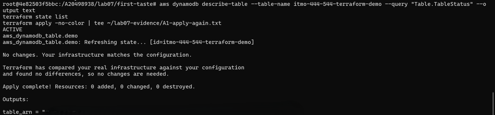

The table is ACTIVE, and the second apply shows No changes.

5.
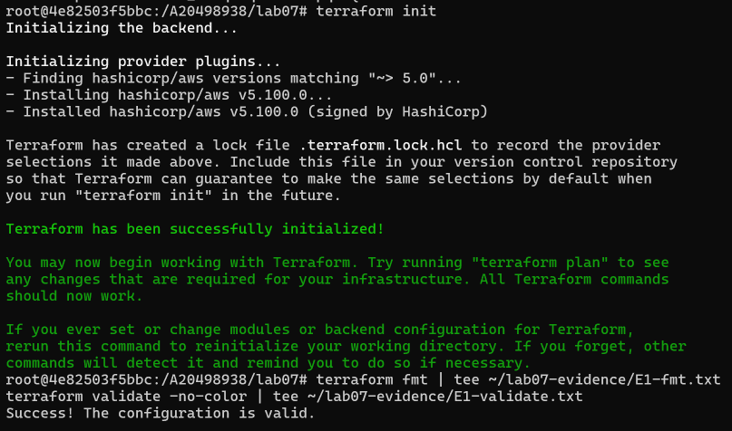

terraform init, fmt and validate. The code is valid.

6.
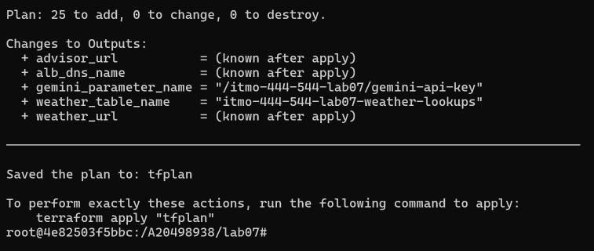

The plan will add 25 resources. It is saved as tfplan.

7.
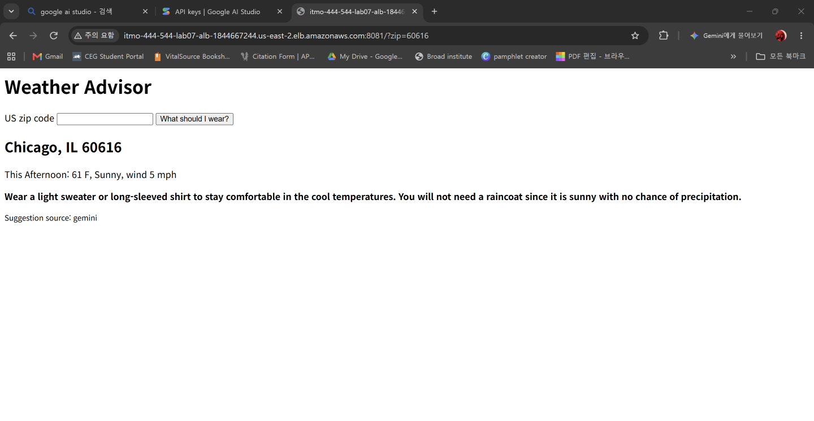

The advisor web page works. The advice comes from Gemini.

8.
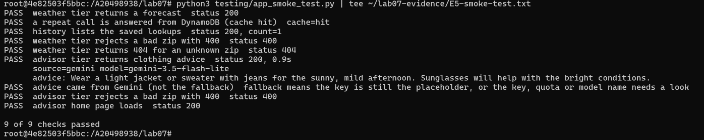

The smoke test passes all 9 checks.

9.
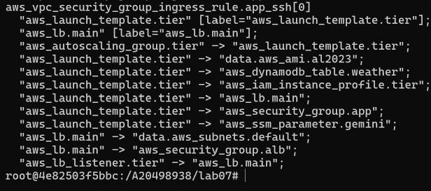

The graph shows the launch template waits for the load balancer.

10.
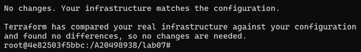

Running plan again shows No changes.

11.
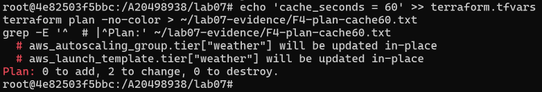

Changing cache_seconds to 60 only changes the weather tier.

12.
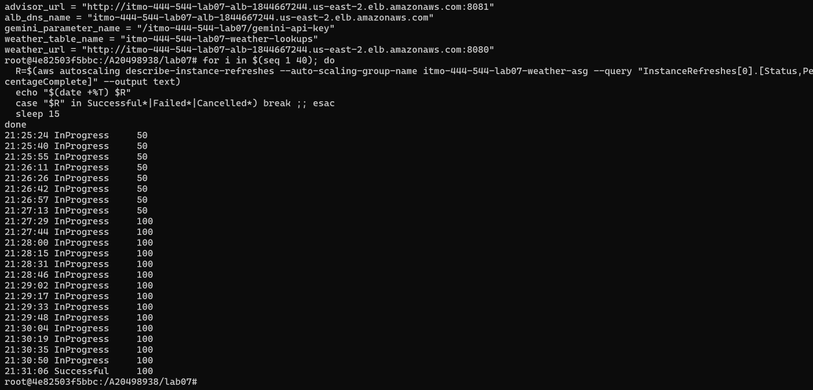

The instance refresh is done. The new weather instance is ready.

13.
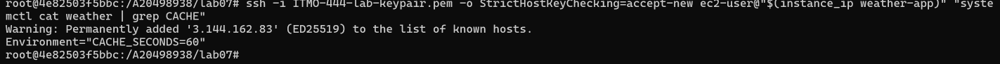

The new weather instance has CACHE_SECONDS=60.

14.
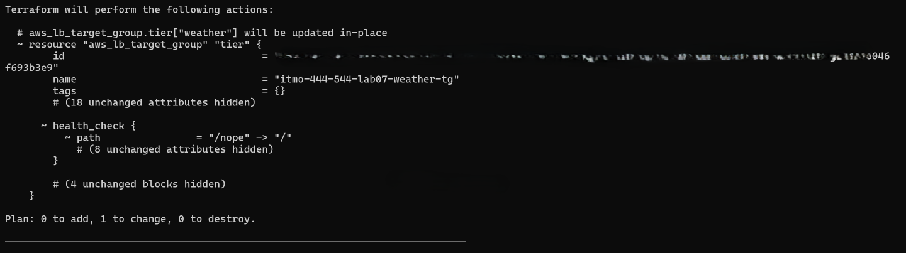

I changed the health check path by hand. Terraform wants to change it back to /.

15.
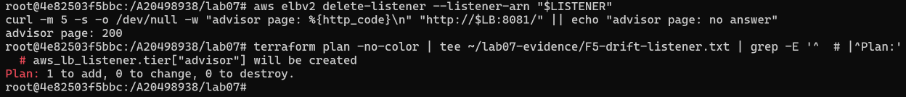

I deleted the advisor listener by hand. Terraform wants to add it back.

16.
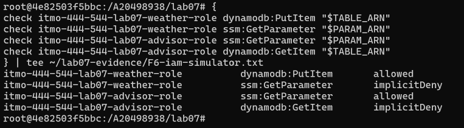

Each role can only do its own job. Everything else is denied.

17.
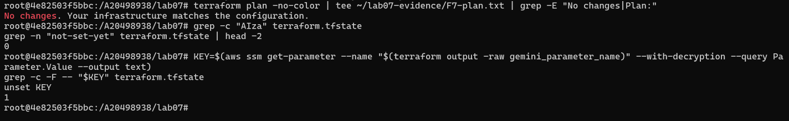

Plan shows No changes, but my real key was found once in the state file.

18.
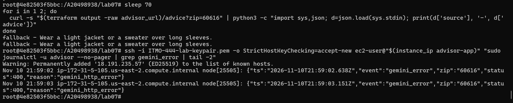

With a fake key, the advisor gives fallback answers. The log shows the error.

19.
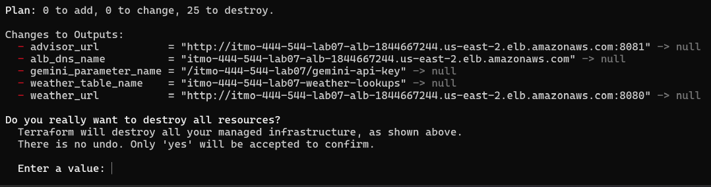

The destroy plan will remove all 25 resources.

20.
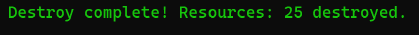

Destroy is done. All 25 resources are gone.

21.
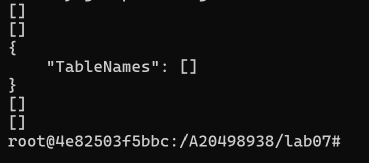

The checks show nothing is left in AWS.

Questions

1. Part A: Why Is the -/+ Plan the One to Be Careful About?

A ~ plan changes the table and keeps the data. A -/+ plan deletes the table and makes a new one, so all the data is lost. So I did not apply it.

2. Step 1: Where Did the Effort Go Down?

Lines to create the stack: lab06 bash about 420 in the reference version, lab07 Terraform 432

Lines to delete the stack: lab06 bash 2 delete scripts, lab07 Terraform 0

Steps you had to order by hand: lab06 bash 9 or more, lab07 Terraform 0

Helper functions you wrote: lab06 bash many ensure_ helpers, lab07 Terraform 0

Retry or wait loops you wrote: lab06 bash some wait, sleep and retry loops, lab07 Terraform 0

Terraform was not shorter. But I did not need a delete script, an order of steps, or wait loops. Terraform does these for me.

3. Step 2: What If the WEATHER_URL Line Were Removed?

The WEATHER_URL line makes the launch template wait for the load balancer. Without it, Terraform would not wait, and the advisor would break because it would not know where the weather service is.

4. Step 3: How Is No Changes Different from Running the Bash Script Twice?

Terraform checks if the settings still match. The bash script only checked if the name existed and said "skipping".

5. Step 4: How Many Commands Did the Change Take?

Three: edit terraform.tfvars, plan and apply. Terraform replaced the weather instance by itself. In lab06 it took four steps, and I had to stop the instance myself.

6. Step 5: How Is Drift Detection Different from ensure_target_group?

Terraform found both of my hand changes and fixed them with one apply. ensure_target_group only checked the name and said "skipping", so it would miss them.

7. Step 6: What Does an Attacker Get from the Advisor Tier?

Only the Gemini key. They cannot touch the weather table or anything else.

8. Step 7: What Does ignore_changes Do?

It stops Terraform from overwriting my real key. Without it, the next apply would put not-set-yet back, and the advisor would only give fallback answers.

But my real key still got into the state file, because Terraform reads the value every time it refreshes. The AIza check showed 0 only because my key starts with AQ. So the state file must be kept secret.

9. Step 8: What Is the Problem with a Silent Fallback?

Users never see an error, so nobody knows the key is broken. The problem could last for days. We need an alarm on gemini_error.

10. Step 9: What Would Change If the Advisor Were a Lambda Function?

Goes away: the advisor's launch template, Auto Scaling Group and instance profile.

Stays: the load balancer, the listener, the Gemini key parameter, the policy, the role for Lambda, and the target group as type lambda.

New: the Lambda function, a permission for the load balancer to call it, a target group attachment, a log permission, and code changed to a handler.

Launch template and user-data: Lambda function with a code zip. Effort moved to Lambda.

Auto Scaling Group and instance refresh: Not needed, Lambda scales by itself. Effort moved to Lambda.

App security group rule for port 3000: Not needed, but needs a Lambda permission. Effort moved to Lambda and me.

Instance profile and role: Only a role for Lambda. Effort moved to Terraform.

Node.js install and systemd service: Not needed, AWS runs Node.js. Effort moved to Lambda, but I must change the code.

Health check and grace period: Not needed. Effort moved to Lambda.

Lambda removes the servers. Terraform already removed the delete script and the waiting. I gain fast deploys and no servers to manage. I take on slow first requests, a 15 minute time limit, and harder testing because I cannot SSH in.

11. How Is Terraform Like AWS Lambda, and Where Does the Comparison Stop?

Both take a small piece from me and do the hard work. Both run only when called. But Lambda runs my app and keeps no state. Terraform builds the infrastructure and keeps a state file.

12. What Did Terraform Not Make Easier?

It was not shorter. I had to learn a new language and protect the state file. Some steps were still manual, like saving the key. It also could not fix outside problems: the key format changed to AQ., and the Gemini 3.1 model timed out, so I switched to gemini-3.5-flash-lite.

13. Section 13.1 Review Questions

Declarative and imperative: Bash is good for one-time steps like saving a key. Terraform shows a plan, finds drift, and deletes everything with one command.

State file: If it is lost, Terraform forgets what it made. If two people use different copies, they overwrite each other. Teams keep it in a shared S3 bucket with locking.

Secrets in state: Passwords, secret values and outputs can end up in the state. A plan file also holds these values, so it is secret too.

Plan before apply: It shows what will change before it happens. -/+ worries me most because it deletes and recreates.

Version pinning: Without a pin, a new provider version could break my code. The lock file makes everyone use the same version.

for_each or count: for_each uses names, so removing one tier only removes that tier. count uses numbers, so removing one can change the others.

Ownership: They undo each other's changes. Terraform should own its own resources.

Drift: Run terraform plan on a schedule and send an alert when something changed. Only a few people should change things by hand.

Blast radius: Only things that depend on the change are touched. Splitting the stack into smaller parts makes it even smaller.

Least privilege: A reference always points to the right resource and has no typos. A typed ARN can be wrong.

Terraform and Lambda: Both do the hard work for me. Terraform builds infrastructure and keeps state. Lambda runs code and keeps no state.

Destroy: Protect resources with data, like databases and tables. Use prevent_destroy and deletion protection.

14. Step 10: How Long Did It Run and What Did It Cost?

Destroy removed all 25 resources in a few minutes. The stack ran about 1.5 hours, so 1.5 x $0.07 = about $0.11. Nothing is left in AWS. I also deleted the Gemini key.
